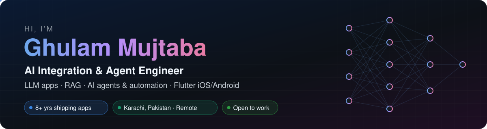
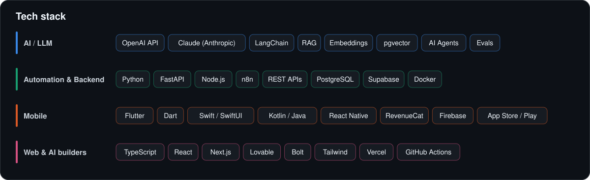
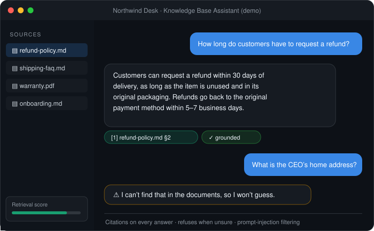
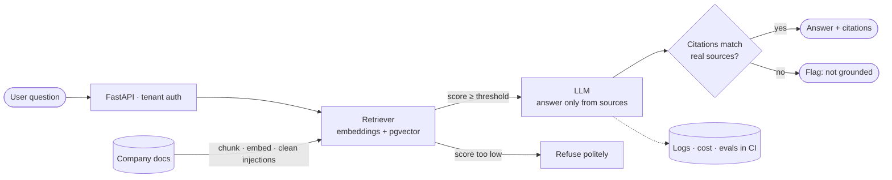
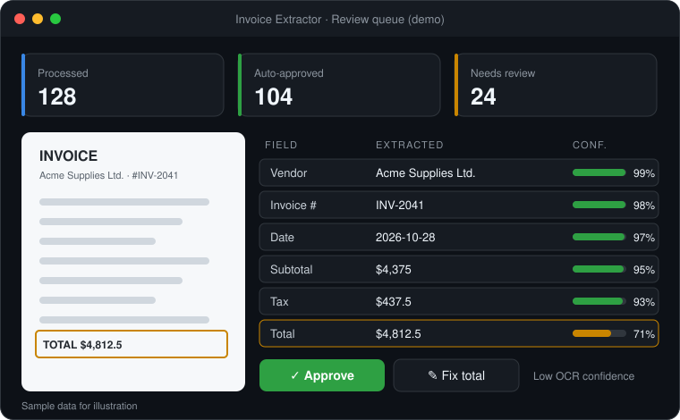
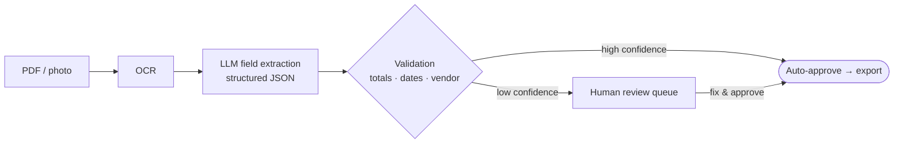
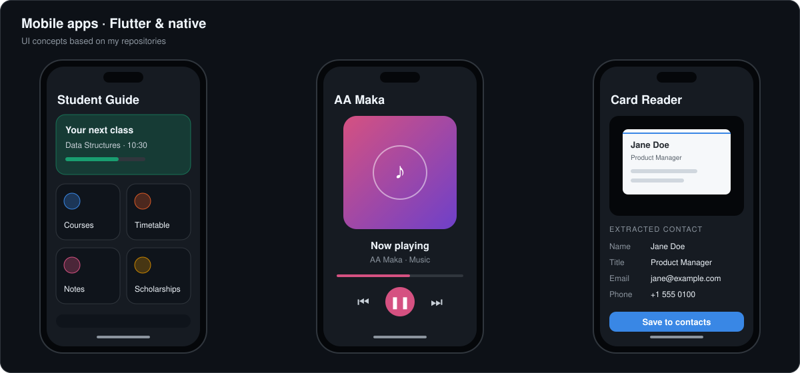
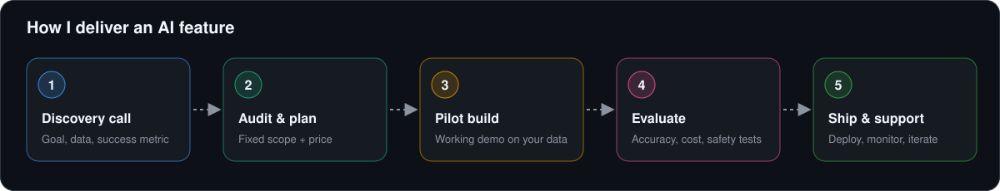
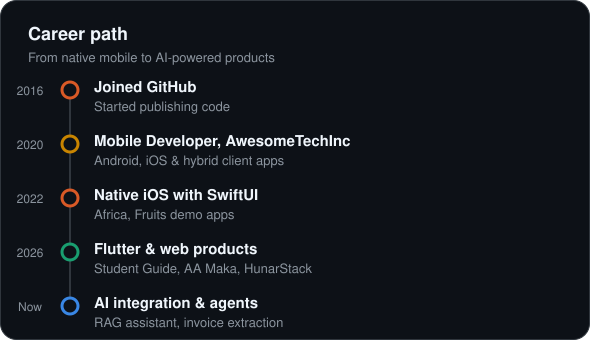

  

  

  
  
  
  

---

## 👋 About me

I'm a software engineer from **Karachi, Pakistan** with **8+ years** of shipping mobile apps for clients worldwide. Today I help SaaS companies and growing businesses **put AI to work inside the products they already have**:

- 🤖 **AI chatbots & RAG assistants** that answer from *your* documents, cite sources and refuse to guess
- 🧠 **AI agents & automation** (OpenAI, Claude, n8n) that take repetitive work off your team
- 📄 **Document & invoice extraction** with validation and a human review queue
- 📱 **AI-powered Flutter apps** for iOS & Android, plus RevenueCat subscriptions
- 🛠️ **Fixing & finishing apps built with Lovable / Bolt** so they're ready for real users

---

## 🚀 Featured AI projects

### 📚 [Knowledge Base Assistant (RAG)](https://github.com/MujtabaJ/kb-assistant)
An assistant that answers **only from a company's own documents**: every answer has citations, it refuses when the documents don't cover the question, and it filters prompt-injection text before the model sees it. Multi-tenant API, tests, an evaluation gate in CI, structured logs and cost tracking.

### 🧾 [Invoice Extractor](https://github.com/MujtabaJ/invoice-extractor)
OCR + LLM extraction of invoice fields with **validation rules and confidence scores**. Clean invoices are approved automatically; anything uncertain goes to a human review queue.

---

## 📱 Mobile apps

| Project | What it is | Stack |
|---|---|---|
| [Student Guide](https://github.com/MujtabaJ/studentguide) | Student companion app | Flutter · Dart |
| [AA Maka](https://github.com/MujtabaJ/aamaka) | Music app | TypeScript |
| [HunarStack](https://github.com/MujtabaJ/hunarstack) | Website & product hub | JavaScript |
| Business Card Reader | Scans business cards into contacts ([privacy pages](https://github.com/MujtabaJ/business-card-reader-legal)) | Android |
| [Africa](https://github.com/MujtabaJ/Africa) · [Fruits](https://github.com/MujtabaJ/Fruits) | SwiftUI showcase apps | Swift · SwiftUI |

---

## 🛠️ How I work

---

## 📊 By the numbers

  
  

  
  

  

  

---

## 🤝 Let's work together

Have an AI idea, a half-finished app, or a manual process that eats your team's time? I offer a **free 30-minute call** to scope it, then a fixed-price audit or pilot so you see results before committing to a bigger build.

  

Mockups above illustrate my demo projects with sample data · Stats update automatically

